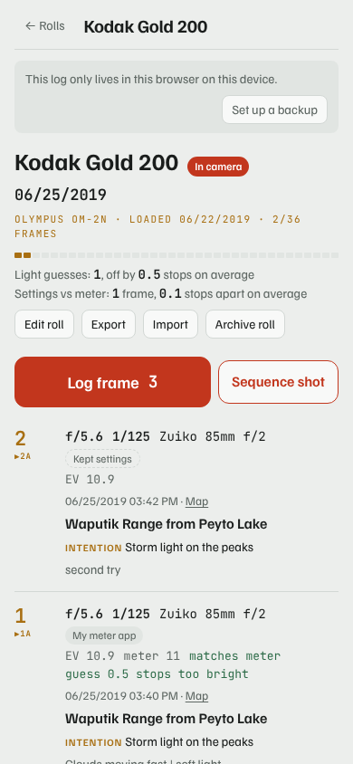
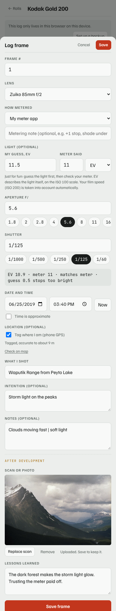
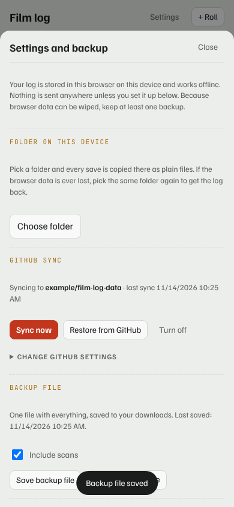

# Film Log

A small logbook for film photography that runs in the browser. Note each frame as you
shoot it, attach the scan when it comes back from the lab, and write down what you
learned. It works offline, installs to the phone's home screen, and keeps your data on
your device.

**Open the app: https://joergbrech.github.io/film-log/** · [How to use it](https://joergbrech.github.io/film-log/docs.html)

[](https://github.com/joergbrech/film-log/actions/workflows/test.yml)

<p>
  
  
  
</p>

<sub>Sample photo: ["Waputik Range"](https://commons.wikimedia.org/wiki/File:Waputik_Range.jpg) by Jeekyu1980, [CC BY-SA 4.0](https://creativecommons.org/licenses/by-sa/4.0/), scaled down. Camera, lens, film and exposure follow the photographer's description; the time, meter readings, notes and lesson in the sample data are made up.</sub>

## What it does

- **Rolls**: film, camera, default lens, loaded and archived dates, lab and development details.
- **Frames**: aperture, shutter, lens, how you metered, date and time, subject, intention, notes.
- **Sequence shot**: one tap copies the previous frame for a series of the same scene.
- **Light**: enter the meter reading (EV or lux) and see the EV of your settings and how far
  off they are. Guess the light first and the log tells you how close you were.
- **Location**: tag frames with the phone's GPS.
- **After development**: attach a scan to each frame and note the lesson learned.
- **Backups you control**: a folder on the device, a private GitHub repository, or a single
  backup file. All plain JSON and Markdown.
- **Markdown export and import**, for example for Obsidian.
- **`tools/tag_scans.py`**: writes the logged data into the EXIF of your lab scans.

There is no account, no server and no tracking. See [Privacy](#privacy).

## Use it on your phone

The full instructions are on the [How to use it](https://joergbrech.github.io/film-log/docs.html) page, also reachable in the app under **Settings**. In short:

1. **Home screen button.** Open https://joergbrech.github.io/film-log/ in Chrome on Android, tap **⋮ › Add to Home screen ›
   Install**. It then opens full screen with its own icon, also without a connection.
   On iOS use Safari: **Share › Add to Home Screen**.
2. **Location.** When logging a frame, switch on **Tag where I am** and allow location once.
3. **Folder backup.** **Settings › Folder on this device › Choose folder**, pick or create a
   folder such as `Documents/FilmLog` and allow access. Every save is copied there. To get
   the log back after the browser data was lost, choose the same folder again. Needs a recent
   Chrome on Android, or Chrome or Edge on a computer. Other browsers can use **Save backup file**.
4. **GitHub sync** (optional). Create an empty **private** repository, then a fine-grained
   personal access token limited to that repository with **Contents: Read and write**. Enter
   owner, repository and token under **Settings › GitHub sync** and tap **Save and test**.

## Host your own copy

The app is static files with no build step.

1. Fork or copy this repository.
2. On GitHub: **Settings › Pages › Build and deployment › Deploy from a branch**, pick `main`
   and `/ (root)`.
3. Open `https://<your-user>.github.io/<repository>/`.

Notes:

- GitHub Pages serves private repositories only on paid plans. On the free plan the
  repository has to be public for Pages to work. That is fine: the repository contains only
  the app, never anyone's log.
- Any static host with HTTPS works (Cloudflare Pages, Netlify, your own server). HTTPS is
  required for offline use, location and folder access.
- To try it locally: `python3 -m http.server` in the repository folder, then open
  `http://localhost:8000/`.

## How it is built

| File | Role |
|---|---|
| `index.html`, `app.css`, `app.js` | The user interface |
| `store.js` | Storage in IndexedDB: documents, scans, settings |
| `sync.js` | Folder backup, GitHub sync, backup file |
| `sw.js`, `manifest.webmanifest`, `icons/` | Offline use and installation |
| `docs.html` | The in-app documentation |
| `tools/tag_scans.py` | EXIF tagging of scans (Python, needs ExifTool) |
| `tests/e2e.js`, `package.json` | End-to-end test in headless Chromium (needs Playwright) |

Backups and sync share one layout:

```
settings.json                      lens and camera lists
rolls/<rollId>.json                the roll and its frames (what restore reads)
rolls/<rollId>.md                  the same roll as a Markdown table
scans/<rollId>/<frame>-<id>.jpg    attached scans
```

Sync is a one-way push from the device; restore merges and never deletes. Where a frame
exists on both sides, the one with the later `updatedAt` wins.

When you change the app, raise `VERSION` in `app.js` and `CACHE` in `sw.js` together so
installed copies pick up the new files.

### Tests

```
npm install
npx playwright install chromium
npm test
```

GitHub Actions runs the same test on every push and pull request (`.github/workflows/test.yml`).

The test drives the real app against a local server, a stand-in folder and a fake GitHub API.
It cannot press the system folder picker or the install prompt, so those two steps are only
tested by hand.

## Privacy

- Rolls, frames, locations and scans are stored in the browser on your device.
- Data leaves the device only where you set it up: the folder you chose, the GitHub
  repository you named, or a file you saved.
- The GitHub token is stored in the browser only and is sent only to `api.github.com`.
- The site sets no cookies and loads nothing from other servers. Fonts are bundled.

## AI disclaimer

This app, its documentation and the helper script were written almost entirely by an AI
coding assistant (Claude, by Anthropic), directed and checked by a human. It has automated
tests, but nobody has audited it line by line. Expect the occasional bug, and keep a backup
of anything you would miss.

## Licence

Film Log is free software under the [WTFPL, version 2](LICENSE): do what you want with it.

THE SOFTWARE IS PROVIDED "AS IS", WITHOUT WARRANTY OF ANY KIND, EXPRESS OR IMPLIED. IN NO
EVENT SHALL THE AUTHORS BE LIABLE FOR ANY CLAIM, DAMAGES OR OTHER LIABILITY ARISING FROM
THE USE OF THE SOFTWARE.

The bundled fonts, Familjen Grotesk and JetBrains Mono, are under the SIL Open Font License
1.1. The sample photo in the screenshots and the test is under CC BY-SA 4.0. See
[THIRD-PARTY-NOTICES.md](THIRD-PARTY-NOTICES.md). The app contains no other third-party code.
